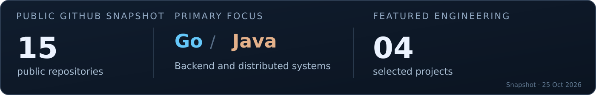

<!-- Profile README v3 | Designed for GitHub's real 700px-wide content column -->

<a href="#featured-projects"><strong>Explore projects</strong></a> &nbsp;·&nbsp; <a href="mailto:aidar.nazarov.2013@mail.com"><strong>Get in touch</strong></a>

## About me

I build backend services in **Go and Java**, with an interest in distributed systems, event-driven communication and reliable data processing.

<table width="100%">
<tr>
<td width="53%" valign="top">
<strong>ENGINEERING FOCUS</strong> 
REST &amp; gRPC APIs · Microservices 
Messaging · SQL &amp; analytical databases 
Docker · Infrastructure &amp; observability
</td>
<td width="47%" valign="top">
<strong>AT A GLANCE</strong> 
ITMO University · Master's (2024–2026) 
Saint Petersburg · Open to relocation 
English: B2 · Open to backend roles
</td>
</tr>
</table>

## Tech stack

<table width="100%">
<tr><td align="left" width="24%"><strong>LANGUAGES</strong></td>
<td align="center" width="19%"> Go</td>
<td align="center" width="19%"> Java</td>
<td align="center" width="19%"> Python</td>
<td align="center" width="19%"> C#</td>
</tr>
<tr><td align="left" width="24%"><strong>BACKEND &amp; MESSAGING</strong></td>
<td align="center" width="19%"> Spring Boot</td>
<td align="center" width="19%"> gRPC</td>
<td align="center" width="19%"> Kafka</td>
<td align="center" width="19%"> RabbitMQ</td>
</tr>
<tr><td align="left" width="24%"><strong>DATABASES &amp; STORAGE</strong></td>
<td align="center" width="19%"> PostgreSQL</td>
<td align="center" width="19%"> ClickHouse</td>
<td align="center" width="19%"> Redis</td>
<td align="center" width="19%"><strong>MinIO</strong> Object storage</td>
</tr>
<tr><td align="left" width="24%"><strong>INFRASTRUCTURE</strong></td>
<td align="center" width="19%"> Docker</td>
<td align="center" width="19%"> Kubernetes</td>
<td align="center" width="19%"> Linux</td>
<td align="center" width="19%"> Terraform</td>
</tr>
<tr><td align="left" width="24%"><strong>TOOLS &amp; OBSERVABILITY</strong></td>
<td align="center" width="19%"> Git</td>
<td align="center" width="19%"> GitHub Actions</td>
<td align="center" width="19%"> Prometheus</td>
<td align="center" width="19%"> Grafana</td>
</tr>
</table>

## Featured projects

&nbsp; 
&nbsp;

<a href="https://github.com/GrimVeqsum?tab=repositories">All repositories →</a>

## GitHub insights

## Contribution activity

<!-- IMPORTANT: Do not replace assets/snake.svg when updating the profile: it's generated by the existing Actions workflow. -->

## Contact

&nbsp;

