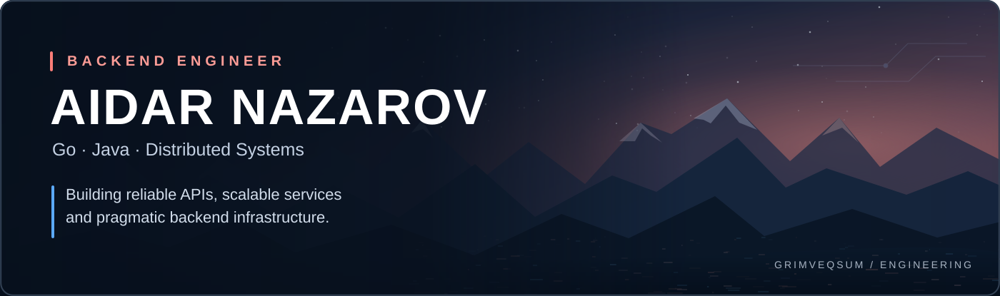
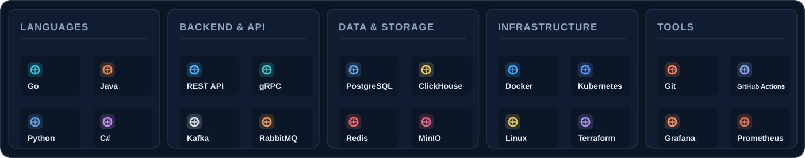
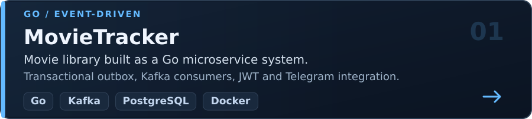
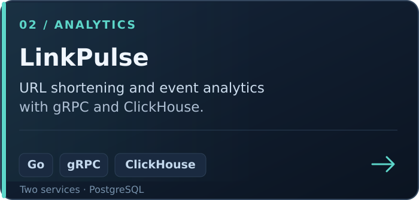
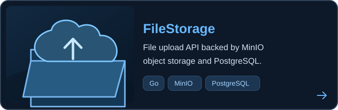
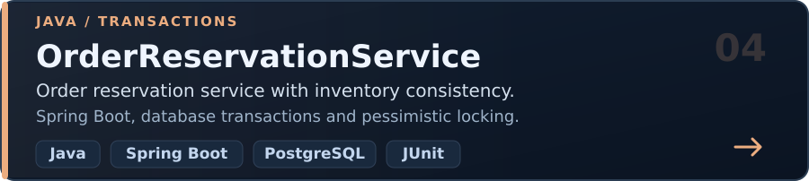

<!--
  GrimVeqsum • GitHub Profile
  All visual elements under assets/ are local SVG files.
  These assets can be customized in tools/generate_assets.py.
-->

 

<a href="https://github.com/GrimVeqsum?tab=repositories"><b>Explore my projects</b></a>
&nbsp;&nbsp; · &nbsp;&nbsp;
<a href="mailto:aidar.nazarov.2013@mail.com"><b>Get in touch</b></a>

 

## About me

I'm a backend developer focused on **Go**, **Java**, APIs, and distributed systems. I enjoy designing reliable services, integrating databases and message brokers, and making infrastructure reproducible and observable.

<table>
  <tr>
    <td width="50%" valign="top">
      <b>What I work with</b> 
      REST &amp; gRPC APIs, microservices, asynchronous processing, PostgreSQL, ClickHouse and object storage.
    </td>
    <td width="50%" valign="top">
      <b>At a glance</b> 
      📍 Saint Petersburg · Open to relocation 
      🎓 ITMO University · Master's programme (2024–2026) 
      🌍 English B2 · Open to backend opportunities
    </td>
  </tr>
</table>

 

## Tech stack

 

## Featured projects

<table>
  <tr>
    <td width="50%"></td>
    <td width="50%"></td>
  </tr>
  <tr>
    <td width="50%"></td>
    <td width="50%"></td>
  </tr>
</table>

<a href="https://github.com/GrimVeqsum?tab=repositories">View all repositories →</a>

 

## Activity

<!-- Activity graph is generated by a third-party service, not a hardcoded contribution counter. -->

  

  
<b>Contribution snake</b> · animated contribution history

   
  

 

## GitHub analytics

<!-- Live cards rely on github-readme-stats; GitHub's native profile remains the fallback. -->

  
  

 

## Contact

  
  &nbsp;
  

